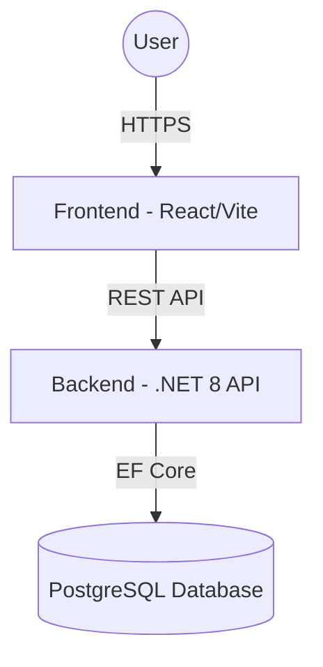

# System Architecture

CareBase follows a **distributed micro-monolith** architecture, designed for scalability and maintainability in healthcare settings.

## High-Level Overview

## Core Components

### 1. Frontend (React + TypeScript)

- Built with Vite for rapid development and optimized builds.
- Uses React Context for state management (Auth, Roles).
- Service-oriented architecture for API communication.

### 2. Backend (ASP.NET Core 8)

- Organized into Clean Architecture layers:
- **CareBase.API**: Controllers, Middleware, Filters.
- **CareBase.Core**: Business logic, Entities, Interfaces.
- **CareBase.Infrastructure**: Data access (EF Core), Repositories.
- **CareBase.Shared**: Common DTOs and Utilities.

### 3. Database (PostgreSQL)

- Relational schema managed via EF Core Migrations and manual SQL scripts.
- Optimized for clinical data consistency and audit logging.

## Security

- JWT (JSON Web Tokens) for stateless authentication.
- Role-based Access Control (RBAC) enforced at the API level.
- CORS policies to restrict access to trusted origins.
